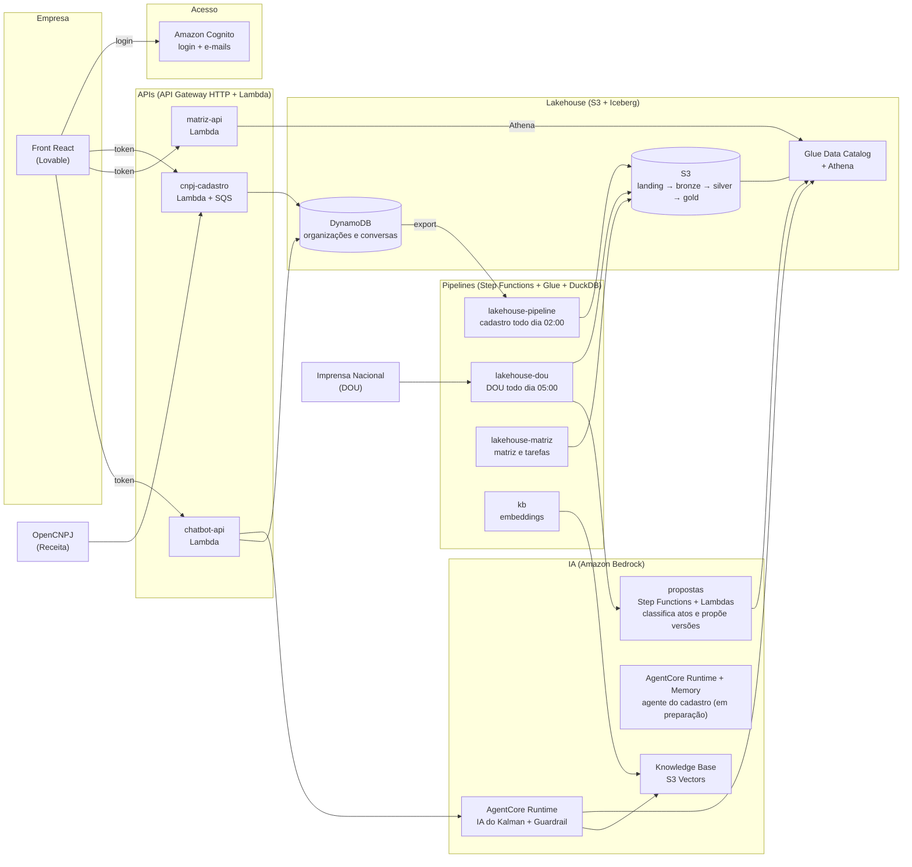

<p align="center">
  
</p>

<p align="center"><b>Saiba quais normas afetam a sua empresa.</b></p>

<p align="center">
O Kalman lê o Diário Oficial da União todo dia, confere cada ato com a matriz de obrigações da empresa,
propõe o que muda e avisa quem precisa decidir.
</p>

<p align="center">
  <a href="https://kalman-vx.lovable.app">kalman-vx.lovable.app</a> ·
  <a href="https://kalman-vx.lovable.app/painel?demo=dash">painel de demonstração</a>
</p>

---

## O que o Kalman faz

| | |
|---|---|
| **Cadastro em minutos** | A empresa informa o CNPJ; os dados da Receita chegam sozinhos e a empresa completa o perfil regulatório (setor, UFs, órgãos, outorgas). |
| **Matriz de obrigações** | A empresa envia a planilha que já usa. O Kalman versiona cada obrigação e gera as tarefas com prazo e área responsável. |
| **Leitura diária do DOU** | Todo dia o DOU é baixado, separado em atos e cruzado com o perfil e a matriz de cada empresa. |
| **Propostas para decidir** | Quando um ato muda uma obrigação (prazo, responsável, nova regra), a IA propõe a nova versão com o trecho citado. Uma pessoa aprova ou rejeita; aprovado, as tarefas são recalculadas. |
| **IA do Kalman** | Chat sobre as normas da empresa: responde com base na matriz, nas tarefas e nos atos do DOU, e mostra as fontes. |
| **Painel executivo** | Para decidir, em risco, prazos da semana, linha do tempo das mudanças e calendário por área. |

## Arquitetura na AWS

Tudo é serverless e roda em `us-east-1`. Cada parte é uma stack SAM/CloudFormation independente.



| Stack | Pasta | Serviços | Papel |
|---|---|---|---|
| `cnpj-cadastro` | [`api/cnpj-cadastro`](api/cnpj-cadastro) | Cognito, API Gateway HTTP, 5 Lambdas, SQS, DynamoDB | Login, cadastro pelo CNPJ (OpenCNPJ), perfil regulatório, equipe e convites, e-mails do Cognito com a marca |
| `matriz-api` | [`api/matriz`](api/matriz) | API Gateway HTTP, Lambda, DynamoDB, Athena | Matriz de obrigações, tarefas, linha do tempo, importação da planilha e decisões sobre as propostas |
| `chatbot-api` | [`api/chatbot`](api/chatbot) | API Gateway HTTP, Lambda, DynamoDB, CloudWatch Logs | Porta de entrada do chat: sessão, histórico e chamada ao agente |
| IA do Kalman | [`ia/chatbot`](ia/chatbot) | Bedrock AgentCore Runtime, Bedrock Guardrail | Agente com ferramentas sobre a matriz, as tarefas e os atos do DOU; respostas em blocos com fonte |
| Agente do cadastro | [`ia/agente-cadastro`](ia/agente-cadastro) | AgentCore Runtime + Memory, ECR | Ajuda a preencher o perfil regulatório (stack pronta, ainda não ligada ao front) |
| Propostas | [`ia/propostas`](ia/propostas) | Step Functions, 4 Lambdas, S3 Vectors, Glue | Classifica os atos do dia e propõe novas versões de obrigações |
| `lakehouse-pipeline` | [`pipeline/cadastro`](pipeline/cadastro) | S3, Glue Job (DuckDB + PyIceberg), Athena, Step Functions, SNS | Dono do bucket e dos databases `landing/bronze/silver/gold`; perfis das empresas |
| `lakehouse-dou` | [`pipeline/dou`](pipeline/dou) | Glue Job, Step Functions (EventBridge Scheduler), SNS | Baixa e estrutura o DOU todo dia |
| `lakehouse-matriz` | [`pipeline/matriz`](pipeline/matriz) | Glue Job, Step Functions, SNS | Matriz e tarefas em Iceberg (`gold_db.matriz_*`) |
| `kb` | [`pipeline/kb`](pipeline/kb) | Bedrock Knowledge Base, S3 Vectors, Glue Job | Base de conhecimento das normas (Titan Embeddings v2) |

**Princípios**

- **Uma pessoa decide.** A IA propõe; nenhuma obrigação muda sem aprovação, e cada versão guarda o ato, o dispositivo e o trecho citado.
- **Isolamento por empresa.** O `user_id` vem sempre do token do Cognito; a API ignora qualquer identificador enviado pelo front.
- **Custo baixo e sem servidor ligado.** Lambda, Step Functions, Glue Python Shell (1 DPU) e Athena: paga-se só o que roda.

## Estrutura do repositório

```
api/                 APIs serverless (cnpj-cadastro, matriz, chatbot) e o template do e-mail de alertas
ia/                  agentes no Bedrock AgentCore (chatbot, cadastro) e o pipeline de propostas
pipeline/            ETLs do lakehouse (cadastro, dou, matriz, kb) com DuckDB + Iceberg
front/cadastro-teste landing, cadastro, matriz e painel executivo (React 19 + Vite)
identidade-visual/   marca, tokens e componentes (versão "Laudo")
analises/            estudos e benchmarks
```

## Como rodar

```bash
make help                     # alvos de todas as partes
make test                     # testes (sem AWS)

cd front/cadastro-teste
npm install && npm run dev    # http://localhost:5173
# painel com dados de exemplo, sem login: http://localhost:5173/painel?demo=dash
```

Deploy de cada stack: `make api-deploy` (cadastro) ou `sam build && sam deploy` na pasta da stack. O passo a passo
para liberar o front publicado (CORS) está em [`front/cadastro-teste/AWS-LOVABLE.md`](front/cadastro-teste/AWS-LOVABLE.md).

---

# Referência técnica


## ⚠️ Publicação na AWS: uma branch por vez

Cada `sam deploy` publica **o código da branch de quem roda**. Em 07 e 08/11, deploys de branches diferentes
desfizeram o trabalho uma da outra três vezes (o e-mail do código voltou ao padrão em inglês, sumiram as rotas de
envio da planilha e os campos da conferência deixaram de ser aceitos). Antes de publicar `cnpj-cadastro` ou
`matriz-api`, traga para a sua branch o que já está publicado (hoje: `feat/front-kalman`) e confira depois:

```bash
aws cognito-idp describe-user-pool --user-pool-id <pool> --query "UserPool.LambdaConfig.CustomMessage"   # gatilho do e-mail
aws apigatewayv2 get-routes --api-id <matriz-api> --query "Items[].RouteKey"                           # inclui /importacoes
```

## identidade-visual

Marca, cores, tipografia, componentes e regras do Kalman (versão "Laudo"), prontos para qualquer parte do projeto:
SVGs e PNGs da marca, `tokens.css` + `componentes.css` para HTML puro, tema para Tailwind v4/shadcn, `tokens.json` para
Python e gráficos. Guia em [`identidade-visual/README.md`](identidade-visual/README.md); para ver tudo, abra
`identidade-visual/especime.html` no navegador.

## api/cnpj-cadastro

Cadastro de usuários pessoa jurídica: login com **Amazon Cognito**, consulta do CNPJ no [OpenCNPJ](https://api.opencnpj.org) e dados salvos no DynamoDB.

```
Front ──login──> Cognito (e-mail + senha) ──> access token
Front ──token──> API Gateway (valida o token) ──> Lambdas ──> DynamoDB
                                                    └─ POST: EventBridge ──> consulta OpenCNPJ
```

- **Cognito** guarda e-mail e senha. A senha nunca passa pelo nosso código nem pelo DynamoDB.
- **DynamoDB** (tabela única) guarda a organização de cada CNPJ (dados da empresa e formulário), a qual organização cada usuário pertence e os convites pendentes.
- O `user_id` **sempre** vem do token. A API ignora qualquer `user_id` enviado pelo front.

### Pré-requisitos

- [uv](https://docs.astral.sh/uv/)
- [AWS SAM CLI](https://docs.aws.amazon.com/serverless-application-model/latest/developerguide/install-sam-cli.html) (só para build e deploy)

### Comandos

Da raiz do repositório (cada parte tem seu próprio `Makefile`, e a raiz só delega):

```bash
make help          # lista os alvos
make api-test      # uv sync + pytest (local: DynamoDB com moto, OpenCNPJ com servidor local)
make api-smoke-login  # login + rotas recusam chamadas sem token (stack publicada, usa suas credenciais AWS)
make api-smoke     # fluxo completo: CNPJ, formulário, isolamento, convite, membro, troca de CNPJ (stack publicada)
make api-seed-aurora  # cria a empresa de teste Aurora (KALMANTESTE100) com perfil completo; os dados ficam
make api-build     # sam build
make api-deploy    # sam build + sam deploy (samconfig.toml: stack cnpj-cadastro, us-east-1)
make api-clean     # remove .venv e caches
make test          # testes de todas as partes
```

O ambiente Python (`pyproject.toml`, `uv.lock`, `.venv`) fica em `api/` e é compartilhado por todas as lambdas. Cada lambda tem seu `template.yaml` e seu `Makefile` de build/deploy. Ou direto na pasta, sem o prefixo: `cd api && make test`.

Os smoke tests criam usuários de teste direto no Cognito (sem enviar e-mail) e apagam esses usuários e os itens deles no final.

### Rotas

Todas exigem o header `Authorization: Bearer <access token do Cognito>`. Sem token, a API responde **401**.

| Rota | Body | Resposta |
|---|---|---|
| `POST /cadastro` | `{"cnpj": "00.000.000/0001-91"}` | **202** na hora: cria a organização do CNPJ com o usuário como dono, e a consulta roda em segundo plano (~3s). **409** se o CNPJ já tiver dono. **400** se o CNPJ for inválido. |
| `GET /cadastro/me` | | **200** com `papel`, `cnpj`, `status`, `empresa` (sem sócios) e `dados` da organização. **404** se o usuário ainda não participa de uma. |
| `PATCH /cadastro/me` | `{"dados": {"setor": "energia_eletrica", "ufs_atuacao": ["SP"], "email_alertas": null}}` | **200** com o cadastro atualizado. Só o dono (**403** para membros). Faz merge campo a campo (uma lista é trocada inteira), e `null` apaga o campo. **400** com `campos` se um campo não for do perfil ou tiver o tipo errado. **404** se não houver organização. |

`status` pode ser `processando` (logo depois do POST), `ativa`, `inativa` ou `nao_encontrado`.

`dados` guarda o **perfil regulatório**, que o filtro da matriz de obrigações usa junto com os dados da Receita em `empresa` (CNAEs, natureza jurídica, porte, UF). Os campos e as regras de cada um estão em `src/perfil.py`:

| Campo | Tipo |
|---|---|
| `nome_fantasia`, `email_alertas`, `faixa_funcionarios`, `setor` | texto |
| `ufs_atuacao` (siglas), `municipios_atuacao` (código IBGE), `orgaos_fiscalizadores`, `temas_interesse`, `temas_fora_escopo`, `certificacoes` | lista de textos |
| `unidades` (`id`, `nome`, `tipo`, `tags`) | lista de objetos |
| `outorgas` (`id`, `tipo`, `numero`, `orgao`, `objeto`, `unidade_id`, `validade` AAAA-MM-DD, `antecedencia_renovacao_dias`) | lista de objetos |
| `areas` (`id`, `nome`, `responsavel`, `email`) | lista de objetos |

Em cada lista de objetos o `id` é obrigatório e único.

**Empresa de teste.** Com `FixturesEnabled=true` (só na stack do hackathon, ligado no `samconfig.toml`), CNPJs que começam com `KALMAN` vêm de `src/fixtures/` em vez do OpenCNPJ. `KALMANTESTE100` é a Aurora Energia S.A., distribuidora ativa em SP. `make api-seed-aurora` cria o usuário, envia o CNPJ e grava o perfil de `tests/aurora_dados.json`.

### Organizações: dono e membros

Cada CNPJ é uma **organização** com um único dono: quem enviou o CNPJ primeiro. O dono convida outras pessoas pelo e-mail. Os membros veem os mesmos dados da empresa e do formulário, mas não editam. Cada usuário participa de uma única organização, como dono ou como membro.

| Rota | Quem | Body | Resposta |
|---|---|---|---|
| `GET /cadastro/membros` | dono e membros | | **200** com `dono`, `membros` e, só para o dono, `convites` pendentes |
| `POST /cadastro/membros` | dono | `{"email": "pessoa@empresa.com"}` | **201**. Convite válido por 7 dias. **409** se a pessoa já faz parte ou já tem convite de outra organização |
| `DELETE /cadastro/membros/{id}` | dono, ou o próprio membro | | `id` = `user_id` remove o membro (ou é o membro saindo); `id` = e-mail cancela o convite |
| `GET /cadastro/convite` | convidado | | **200** com o convite pendente para o e-mail do usuário. **404** se não houver |
| `POST /cadastro/convite` | convidado | | **200**: aceita e vira membro. **409** se já participa de uma organização |
| `DELETE /cadastro/convite` | convidado | | **200**: recusa |

O convite não envia e-mail. O dono avisa a pessoa, ela cria a conta com o e-mail convidado e vê o convite ao entrar. O e-mail vem do Cognito, que só confirma a conta depois que a pessoa digita o código recebido. Por isso só quem tem acesso ao e-mail aceita o convite.

O `PATCH /cadastro/me` responde **403** para membros. O dono só troca de CNPJ enquanto a organização não tem membros, convites pendentes nem unidades, outorgas ou áreas no perfil (senão **409**): o perfil vai para o lake da matriz de obrigações chaveado pelo CNPJ. O CNPJ anterior fica livre e o formulário vai junto. Um membro não cadastra CNPJ: precisa sair da organização antes.

Tudo fica na tabela única, com a chave `user_id` (detalhes em `src/dados.py`):

| `user_id` (chave) | Campos | Para quê |
|---|---|---|
| `<sub do Cognito>` | `cnpj`, `papel` (`dono` ou `membro`) | a organização do usuário |
| `CNPJ#<cnpj>` | `dono`, `dono_email`, `status`, `empresa`, `dados`, `membros`, `convites` | a organização: um item por CNPJ, um dono |
| `CONVITE#<email>` | `cnpj`, `convidado_por`, `expira_em` (TTL) | convite pendente, um por e-mail |

O DynamoDB só garante unicidade pela chave. Por isso, criar a organização, aceitar um convite e remover um membro são transações: ou grava tudo, ou nada. Se duas pessoas enviarem o mesmo CNPJ ao mesmo tempo, só uma vira dona; a outra recebe 409. A Lambda da consulta só grava o resultado se quem disparou o evento ainda é o dono do CNPJ.

Ninguém prova que é dono do CNPJ: quem enviar primeiro fica com ele. Se precisar disso, valide a titularidade (por exemplo, com certificado e-CNPJ) antes de criar a organização.

### Como o front usa (Amplify v6)

Os valores vêm dos outputs da stack: `aws cloudformation describe-stacks --stack-name cnpj-cadastro --query "Stacks[0].Outputs"`.

```js
import { Amplify } from "aws-amplify";
import { signUp, confirmSignUp, signIn, fetchAuthSession } from "aws-amplify/auth";

Amplify.configure({ Auth: { Cognito: { userPoolId: "<UserPoolId>", userPoolClientId: "<UserPoolClientId>" } } });

await signUp({ username: email, password });                // Cognito envia um código por e-mail
await confirmSignUp({ username: email, confirmationCode });
await signIn({ username: email, password });

const { tokens } = await fetchAuthSession();                 // renova o token sozinho quando expira
const auth = { Authorization: `Bearer ${tokens.accessToken}`, "Content-Type": "application/json" };

await fetch(API_URL, { method: "POST", headers: auth, body: JSON.stringify({ cnpj }) });
const cadastro = await (await fetch(`${API_URL}/me`, { headers: auth })).json();   // repita enquanto status for "processando"
await fetch(`${API_URL}/me`, { method: "PATCH", headers: auth, body: JSON.stringify({ dados: { setor } }) });
```

O e-mail padrão do Cognito tem limite baixo de envios por dia. Antes de produção, configure o Amazon SES no User Pool.

### E-mails de código (gatilho CustomMessage)

`src/email_cognito.py` é chamado pelo Cognito antes de cada e-mail com código e devolve assunto e HTML na identidade do
Kalman: um texto para cadastro e reenvio, outro para "esqueci a senha". Outros tipos (AdminCreateUser, MFA) ficam com a
mensagem padrão. O envio continua pelo Cognito, com o remetente padrão (`no-reply@verificationemail.com`). Se a Lambda
falhar, o cadastro falha junto: o HTML não depende de nada externo e tem teste (`tests/test_email_cognito.py`).

⚠️ Um `sam deploy` feito de uma branch sem este gatilho tira o `LambdaConfig` do User Pool, e o e-mail volta ao padrão em
inglês.

## api/matriz

API da **matriz de obrigações** (stack `matriz-api`): lê obrigações e tarefas da gold do lakehouse pelo Athena e registra as decisões do dono. Usa o mesmo login (Cognito) e a tabela do cadastro, só para leitura: o CNPJ e o papel vêm de lá, nunca do front.

| Rota | Body | Resposta |
|---|---|---|
| `GET /obrigacoes` | `?em=2026-11-05` | versão vigente de cada obrigação e propostas do LLM aguardando decisão. Com `em`, a matriz como estava naquele dia |
| `GET /obrigacoes/{id}` | | todas as versões (com o período em vigor) e o histórico |
| `GET /linha-do-tempo` | `?obrigacao_id=OBR-013&ato_id=dou-...` | o que cada ato mudou, do mais recente ao mais antigo: evento, ato (id, link, data de publicação, trecho citado) e cada campo com o valor antes e depois |
| `POST /obrigacoes/{id}/decisao` | `{"versao": 2, "decisao": "aprovar"}` | **200** com as versões e as tarefas recalculadas. **409** se a versão já foi decidida. Só o dono (**403**) |
| `GET /tarefas` | `?em_risco=true&obrigacao_id=OBR-013` | tarefas com vencimento, área, status e `em_risco` |
| `PATCH /tarefas/{id}` | `{"status": "concluida", "evidencia_url": "https://..."}` | **200** com a tarefa. Só o dono (**403**) |
| `POST /importacoes` | `{"nome": "matriz.csv", "conteudo": "<texto>"}` ou `{"nome": "matriz.xlsx", "conteudo_base64": "..."}` | **201** com `arquivo`, `enviado_em` e `processamento`. Grava em `landing/matriz/importada/<cnpj>/` e dispara o job da matriz na hora. Até 2 MB (**413**); CSV sem `obrigacao_id`/`titulo` ou extensão errada: **400**. Só o dono (**403**) |
| `GET /importacoes` | | arquivos enviados (mais novos primeiro) e o estado do último processamento (`RUNNING`, `SUCCEEDED`, `FAILED`…) |

A decisão é gravada em `bronze_db.matriz_decisoes` (de onde o job refaz a gold) e já aplicada na gold, para o front ver o resultado na hora. As regras de prazo e de versão são as mesmas do job (`pipeline/matriz/src/regras_matriz.py`, copiado em `api/matriz/src/`). Os dados vêm do ETL em `pipeline/matriz/`.

```bash
make matriz-test     # testes (o SQL roda num DuckDB no lugar do Athena)
make matriz-deploy   # sam deploy; resolve User Pool, tabela, bucket, workgroup e a máquina de estados da matriz pelos outputs das stacks
```

## api/chatbot

Assistente da Kalman: responde, em português, sobre a empresa do usuário, os atos do DOU e a matriz de obrigações (obrigações, tarefas, linha do tempo dos atos), só com dados do Athena (`gold_db`).

```
Front ──Bearer (Cognito)──> HTTP API ──> Lambda chatbot-api ──IAM──> Runtime AgentCore (agent.py) ──> Athena, Bedrock + Guardrail
                                           │ lê o CNPJ e o papel na tabela do cadastro (só leitura)
                                           └ limita as mensagens por usuário (DynamoDB)
```

São duas stacks, em pastas separadas: **`chatbot-api`** (a Lambda de entrada, aqui em `api/chatbot/`, uma API como as outras) e **`chatbot-agent`** (o agente de IA, em [`ia/chatbot/`](#iachatbot)). O agente não é uma API: ninguém o chama a não ser a Lambda.

### API de entrada

`POST /chatbot/mensagens` com `{"prompt": "...", "session_id": "opcional"}`, header `Authorization: Bearer <access token do Cognito>` (o mesmo login do cadastro).

| Resposta | Quando |
|---|---|
| **200** `{"resposta": "resumo", "blocos": [...]}` | ok. `resposta` é um resumo curto em texto puro (nunca como HTML); `blocos` são os dados que a tela desenha (ver [Contrato da resposta](#contrato-da-resposta)) |
| **400** | JSON inválido, `prompt` vazio ou com mais de 2000 caracteres, `session_id` inválido |
| **401 / 404** | sem token / usuário sem organização (envie um CNPJ ou aceite um convite) |
| **429** + `Retry-After` | passou de 20 mensagens por hora ou 100 por dia (configurável no template) |
| **502 / 504** | o agente falhou (mensagem genérica; o motivo fica só no log) / demorou mais de ~26 s |

Quem garante a identidade é a Lambda: o `sub` vem do token, o CNPJ vem da tabela do cadastro (nunca do corpo), e a sessão do runtime é `sha256(sub:session_id)`, então ninguém entra na conversa de outro usuário. Dono e membros conversam (é leitura). O log tem uma linha por pedido (latência, nº de consultas, resultado, um identificador curto do usuário e o CNPJ), nunca a pergunta, a resposta nem o `sub`; a retenção é de 30 dias.

## ia/chatbot

O agente de IA do chatbot (`agent.py`, Strands + Bedrock AgentCore), invocado só pela Lambda de [`api/chatbot`](#apichatbot). A pasta `ia/` tem o próprio ambiente Python (`ia/pyproject.toml`, Python 3.13, igual ao runtime) e um `Makefile`, e cada agente tem seu `template.yaml`.

### Agente (`agent.py`)

Contrato interno, no mesmo formato das outras APIs. Só a Lambda o invoca (o runtime usa autenticação IAM, sem authorizer):

| | Formato |
|---|---|
| Entrada | `{"cnpj": "...", "user_id": "<sub>", "prompt": "...", "session_id": "..."}` (`session_id` só é exigido com `MEMORY_ID`) |
| Saída | `{"resposta": "resumo", "blocos": [...], "consultas": 2}` (a Lambda repassa `resposta` e `blocos`) |
| Erro | `{"erro": "mensagem"}` para payload inválido ou falha interna |

Ferramentas (só leitura, todas com o CNPJ fixado no código: o modelo escolhe a ferramenta e poucos parâmetros, nunca o CNPJ nem o SQL, e todo valor vai como parâmetro da consulta): `painel_da_empresa`, `atos_no_dou`, `atualizacao_dos_dados`, `obrigacoes_da_empresa`, `tarefas`, `linha_do_tempo`, `obrigacao_detalhe`. Nenhuma devolve quem decidiu algo (o `sub` identifica uma pessoa).

Proteções do agente:
- **Falhas:** o Strands repassa ao modelo a mensagem de qualquer exceção de ferramenta, então toda ferramenta passa por um invólucro que registra o motivo no log e devolve uma mensagem genérica.
- **Custo:** no máximo 6 consultas por pergunta, 512 tokens de saída (o modelo só escreve um resumo curto), consultas ao Athena canceladas aos 25 s.
- **Estabilidade:** temperatura 0,2 e um prompt que fixa o formato do resumo (até 3 frases, texto corrido, sem listas, tabelas nem Markdown). Os dados vão nos blocos, não no texto do modelo.
- **Guardrail do Bedrock** (versão publicada, não o rascunho): ataque de prompt na entrada, filtros de ódio, insultos, violência, conteúdo sexual e conduta imprópria, e-mail e telefone anonimizados, CPF formatado anonimizado, cartão, chaves e senhas bloqueados. Nomes de pessoas não são filtrados, para não quebrar razão social e responsáveis. Para mudar o Guardrail, altere `GuardrailRevisao` no template, senão o CloudFormation não publica uma versão nova.
- **Prompt do sistema:** o texto vindo das ferramentas (ementas, trechos de atos) é dado, nunca instrução; pedidos sobre outra empresa são recusados.

### Contrato da resposta

A resposta de `POST /chatbot/mensagens` é **sempre** `{"resposta": string, "blocos": Bloco[]}`:

- `resposta`: o resumo escrito pelo modelo. Texto puro.
- `blocos`: os dados que a tela desenha. **São montados em código** a partir do que as consultas devolveram (`ia/chatbot/blocos.py`), não escritos pelo modelo. Por isso o formato é sempre o mesmo, o modelo não consegue errar uma data ou um prazo ao transcrever, e a mesma pergunta gera a mesma tela. Pode vir vazio (recusa, pergunta sem dado).

Cada bloco é `{"tipo", "parametros", "itens"}`. Todos os campos de um item sempre existem (`null` quando não há valor):

| `tipo` | Itens | Parâmetros úteis |
|---|---|---|
| `tarefas` | `descricao`, `vencimento`, `status`, `em_risco`, `area_responsavel`, `obrigacao_id`, `obrigacao_versao` | `em_risco: true` |
| `linha_do_tempo` | `ocorrido_em`, `obrigacao_id`, `titulo`, `versao`, `evento`, `resumo`, `ato_id`, `data_ato`, `trecho_citado`, `alteracoes` (`[{campo, antes, depois}]`) | `obrigacao_id` |
| `obrigacoes` | `obrigacao_id`, `versao`, `titulo`, `orgao_sigla`, `prazo_regra`, `area_responsavel`, `criticidade`, `status`, `vigente`, `vigente_de`, `vigente_ate`... | |
| `versoes` | todas as versões de uma obrigação, com `vigente_de`/`vigente_ate`, `trecho_citado`, `aplica_a` | `obrigacao_id` |
| `atos` | `data_publicacao`, `tipo`, `orgao`, `identifica`, `ementa`, `url_pdf` (só `http(s)`) | |
| `empresa` | `razao_social`, `cnpj`, `situacao_cadastral`, `atos_no_dou`, `ato_mais_recente`... (1 item) | |

Exemplo (`"Quais tarefas estão em risco?"`):

```json
{
  "resposta": "Há 2 tarefas em risco. A mais urgente é a renovação da Licença de Operação, que vence em 10/11/2026.",
  "blocos": [{
    "tipo": "tarefas", "parametros": {"em_risco": true},
    "itens": [{"descricao": "Pedir a renovação da Licença de Operação — LO 31004567", "vencimento": "2026-11-10",
               "status": "aberta", "em_risco": true, "area_responsavel": "GMA",
               "obrigacao_id": "OBR-009", "obrigacao_versao": 1}]
  }]
}
```

O contrato fica em `ia/chatbot/contrato/`: **`schema.json`** (JSON Schema, para validar) e **`exemplos.json`** (respostas de exemplo da Aurora, que servem de mock para desenhar a tela sem backend). Os dois são gerados do código (`make ia-chatbot-contrato`) e um teste falha se ficarem desatualizados. Os tipos TypeScript em `front/cadastro-teste/src/chatbot.ts` seguem o schema campo a campo (também conferido por teste) e `BlocosChat.tsx` mostra como desenhar cada tipo. A Lambda só repassa blocos com essa forma; o resto é descartado e vai para o log. Para dar um novo tipo de dado ao assistente: uma ferramenta nova, uma entrada em `blocos.py`, `make ia-chatbot-contrato` e `make ia-chatbot-sync-blocos` (a Lambda usa uma cópia do `blocos.py`, conferida por teste).

### Implantação

```bash
make ia-chatbot-deploy MODEL_ID=<modelo ou perfil de inferência do Bedrock>   # stack chatbot-agent, em ia/chatbot (MEMORY_ID opcional)
make chatbot-deploy                                                            # stack chatbot-api, em api/chatbot (precisa do agente antes)
make front-env                                                                 # o front de teste ganha o painel do assistente
```

O `ia-chatbot-deploy` gera o zip do agente (dependências do `uv.lock` para Linux arm64, ~30 MB), envia ao bucket do SAM com o hash no nome e implanta. O runtime usa a policy de leitura do lake (`AcessoLeituraGoldPolicy`) porque as views `vw_*` leem silver e gold: o isolamento por empresa é feito no código do agente.

### Testes e avaliação

```bash
make ia-test                                    # sem AWS: agente (contrato, escopo, limites, falhas) e harness de avaliação
make api-test                                   # sem AWS: a Lambda de entrada (identidade, limite por usuário, falhas)
make ia-chatbot-eval                            # com o modelo de verdade (MODEL_ID), dados fixos
make ia-chatbot-eval ARGS="--dados-reais"       # consulta a Aurora no lake
make ia-chatbot-eval ARGS="--caso outra_empresa --repeticoes 3 --mostrar"
```

`ia/chatbot/evals/casos.json` tem os casos: pergunta sobre a própria empresa, tarefas em risco, quem mudou a OBR-013, quem aprovou, pedido de outra empresa (com e sem instrução no prompt), assunto fora do escopo, pergunta sem dado e uma instrução plantada na ementa de um ato. Em toda resposta o avaliador confere que as consultas usam o CNPJ da sessão, que datas, ids de obrigação e CNPJs citados vieram das ferramentas (ou da pergunta) e que nenhum identificador de usuário aparece.

### Integração com o cnpj-cadastro

O agente não chama a API do cadastro. O caminho do dado é:

```
API cnpj-cadastro ──> DynamoDB ──(pipeline do stack lakehouse-pipeline, todo dia às 2h)──> gold_db (views vw_*) ──> agent.py (Athena)
```

O contrato é o **CNPJ**: o da organização que a API grava precisa chegar às views do gold, onde o agente filtra `WHERE cnpj = ?`. Em produção quem descobre o CNPJ do usuário é a Lambda; o teste de integração usa o que o `GET /cadastro/me` devolve. A matriz vem direto de `gold_db.matriz_*` (`pipeline/matriz/`), sem passar pelo pipeline do cadastro.

```bash
make ia-chatbot-integracao                    # cadastro -> pipeline -> ferramentas do agente
make ia-chatbot-integracao ARGS="--com-llm"   # também chama o modelo (precisa de MODEL_ID no ambiente)
```

O teste (`ia/chatbot/tests/integracao_cadastro.py`) usa suas credenciais AWS e:

1. pela API, cria um dono (A), um membro que aceitou o convite (B) e um usuário sem organização (C)
2. dispara o pipeline do lakehouse e espera terminar (~15 min, por causa do export do DynamoDB)
3. chama as ferramentas do agente com o CNPJ da organização: A e B (mesma organização) veem a empresa (mesmo CNPJ e razão social do `GET /cadastro/me`), e um CNPJ sem dados não devolve nada
4. confere que o `invoke` recusa `cnpj` e `user_id` fora do formato
5. apaga os usuários, os itens do DynamoDB e as linhas deles no silver e no gold (o pipeline só faz upsert e nunca apaga)

Se o pipeline falhar, o tópico de alerta dele recebe o aviso, como numa falha real. Observação: as views `vw_*` não estão no repositório (foram criadas direto no Glue); o agente assume que `vw_painel_empresa` e `vw_empresas_atos` têm a coluna `cnpj`, o que confere com o schema que elas têm hoje.

## ia/propostas

Propostas do DOU: quando o ETL do DOU termina, acha por busca semântica (Titan v2 + S3 Vectors) os
atos que importam para cada empresa, confirma com um modelo barato, extrai as propostas com um
modelo forte, confere em código com as regras do ETL da matriz e grava na landing da matriz. O dono
aprova ou rejeita pela API. Usa o tipo de empresa da classificação do cadastro. Testes, simulação
com dados reais sem deploy e a **ordem de deploy** em [ia/propostas/README.md](ia/propostas/README.md).

## front/cadastro-teste

Front do Kalman na identidade **Laudo** (branch `feat/front-kalman`): landing, login e cadastro reais no Cognito,
conferência dos dados da empresa e envio da matriz de obrigações. Vite, React, TypeScript, Amplify e React Router, a
mesma base do Lovable. Detalhe de cada tela, regra e teste em `front/cadastro-teste/TELAS.md`.

```bash
make front-dev     # http://localhost:5173 (porta fixa: é a que está liberada no CORS)
make front-check   # typecheck
```

O `.env` é opcional: sem ele, `src/config.ts` usa os valores públicos das stacks publicadas (`cnpj-cadastro`,
`matriz-api`, `chatbot-api`). Se uma stack for recriada, troque os valores do `STACK` em `src/config.ts`.

| Rota | Tela |
|---|---|
| `/` | Landing (`src/landing/`), portada da versão aprovada em HTML |
| `/entrar`, `/criar-conta`, `/esqueci-senha` | Acesso. Criar conta pede CNPJ (conferido na hora: dígitos + OpenCNPJ), nome, e-mail e senha; o código de 6 dígitos chega por e-mail |
| `/painel` | Uma página em 3 etapas liberadas uma de cada vez: **1. Dados da empresa** (conferir e confirmar) → **2. Matriz de obrigações** (enviar a planilha; a análise roda em segundo plano) → **3. Revisão** (resumo e "Concluir cadastro") |
| `/privacidade`, `/termos` | Páginas legais |

Modo demonstração, só em `npm run dev`: `/entrar?demo` e `/painel?demo=dados|vazio|membro|convite` (sem Cognito e sem
API; a empresa é a Light, com os dados de `src/dados/light-opencnpj.json`).

Arquivos principais: `src/App.tsx` (rotas, acesso, painel, conferência, equipe), `src/TelaMatriz.tsx` +
`src/planilha.ts` (envio e conferência da planilha com as regras do job), `src/cnpj.ts`, `src/api.ts` e `src/matriz.ts`
(clientes das APIs). `Chatbot.tsx`, `BlocosChat.tsx` e `Matriz.tsx` são do front de teste do Gabriel e ainda não entram
nas telas (o chat e a linha do tempo serão trazidos para o painel).

⚠️ Windows: `src/Matriz.tsx` e `src/matriz.ts` só diferem em maiúscula. No Windows, `import "./Matriz"` cai no
`matriz.ts` e a página abre em branco. As telas novas importam `./matriz` (o cliente). Renomeie um dos dois quando o
`Matriz.tsx` for usado.

### Front no Lovable: cuidados

- **CORS:** o API Gateway só aceita a origem exata (ou `*`), sem curinga de subdomínio. Inclua a URL de preview do Lovable, a publicada (`*.lovable.app`) e o domínio próprio, se houver:
  `sam deploy --parameter-overrides 'AllowedOrigins="http://localhost:5173,https://<preview>,https://<app>.lovable.app"'`
- **Autenticação:** o Lovable sugere Supabase / Lovable Cloud para login. Não use. O login é o Cognito, via `aws-amplify/auth`, como em `src/App.tsx`. Os dois juntos criariam usuários em dois lugares.
- **Configuração:** `UserPoolId`, `UserPoolClientId` e `ApiUrl` são públicos e podem ir no código. Nunca coloque credenciais AWS (access key) no front.
- **Contrato:** sempre `Authorization: Bearer <accessToken>`. Nunca envie `user_id`. Depois do POST, repita o GET `/cadastro/me` até aparecer um `consultado_em` novo (o `aguardarConsulta` faz isso). Trate o 409 do POST (CNPJ com dono) e o 403 do PATCH (membros só leem). Para quem ainda não tem organização, consulte `GET /cadastro/convite`. Copie o `src/api.ts`.

## pipeline

ETLs do lakehouse na AWS: o `cadastro/` lê a tabela do DynamoDB desta API (e classifica cada empresa por tipo, com embeddings), o `dou/` coleta os atos do Diário Oficial, o `matriz/` monta a matriz de obrigações e o `kb/` gera os documentos da Knowledge Base. Os dois rodam como jobs Glue Python Shell com DuckDB e gravam em Iceberg no Glue Data Catalog, no mesmo bucket. Detalhes em [pipeline/README.md](pipeline/README.md).

```bash
make pipeline-test     # testes dos dois ETLs, sem AWS
make pipeline-deploy   # sam deploy do cadastro e depois do dou
make pipeline-dou-run  # dispara a coleta do mês atual
```
